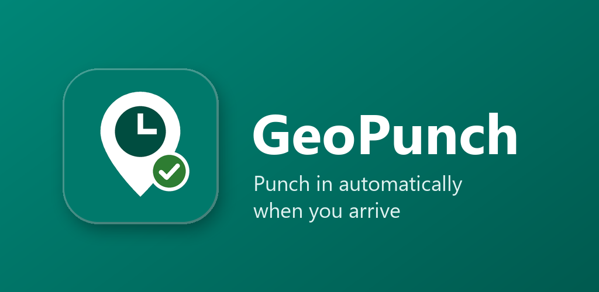
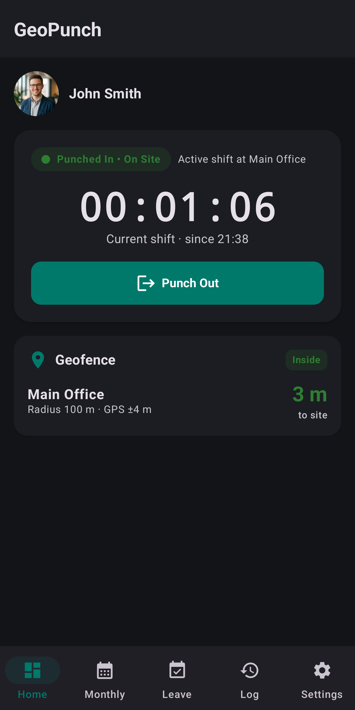
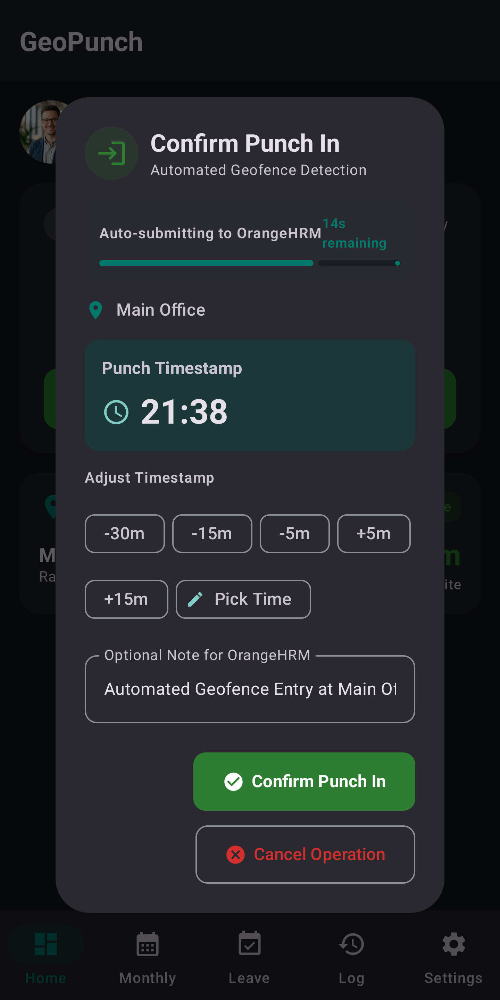
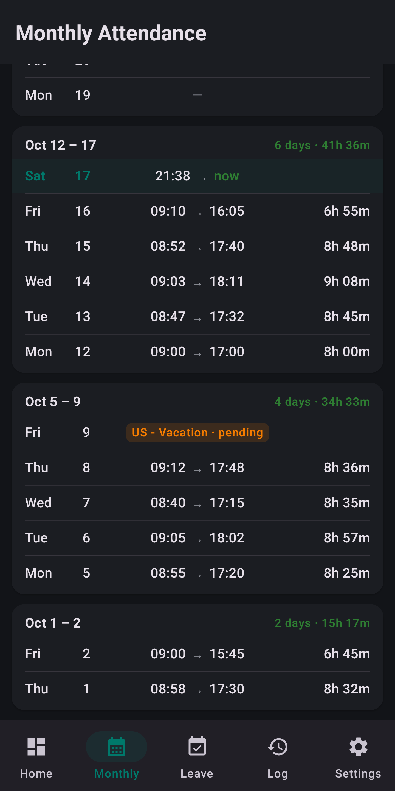
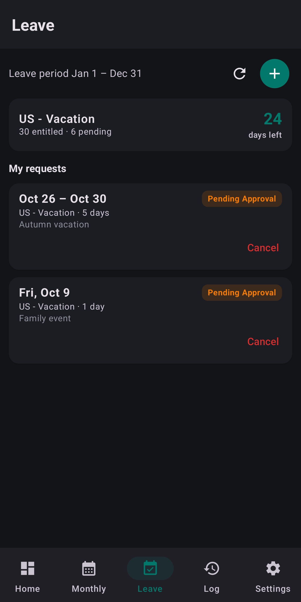
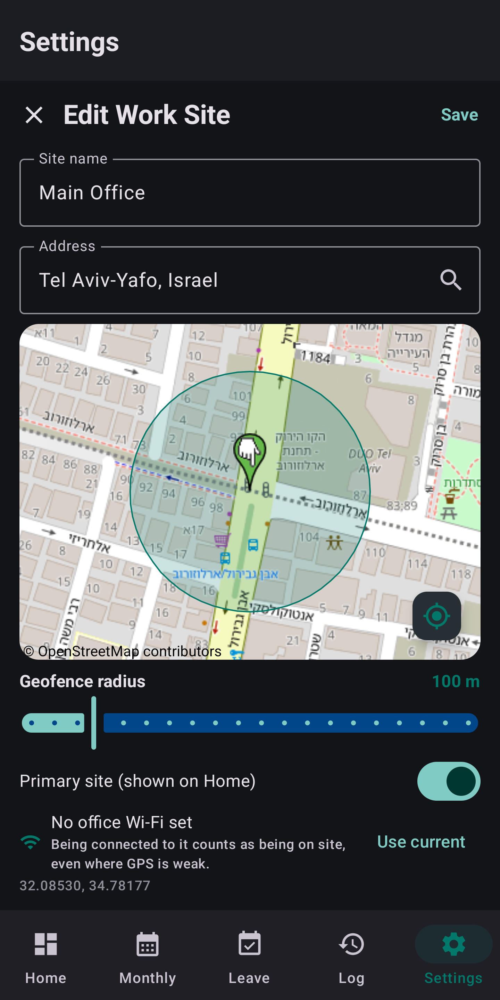
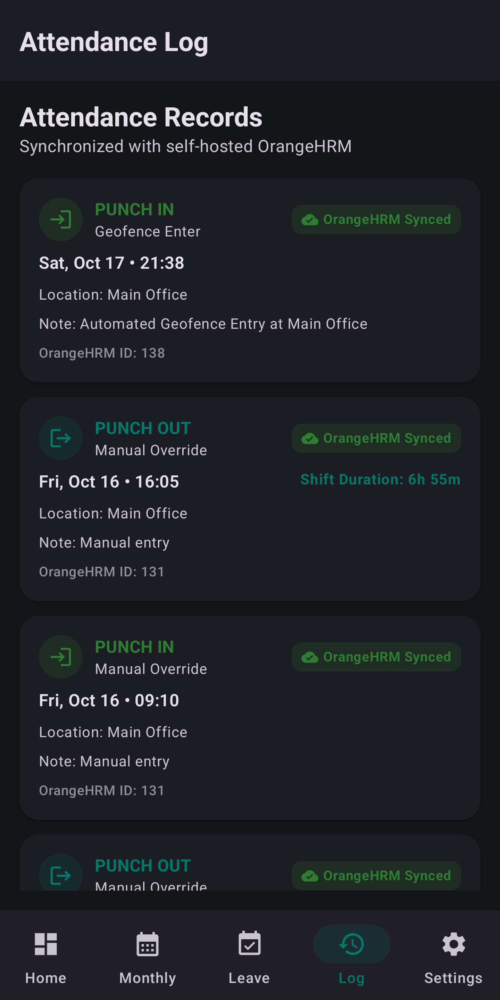
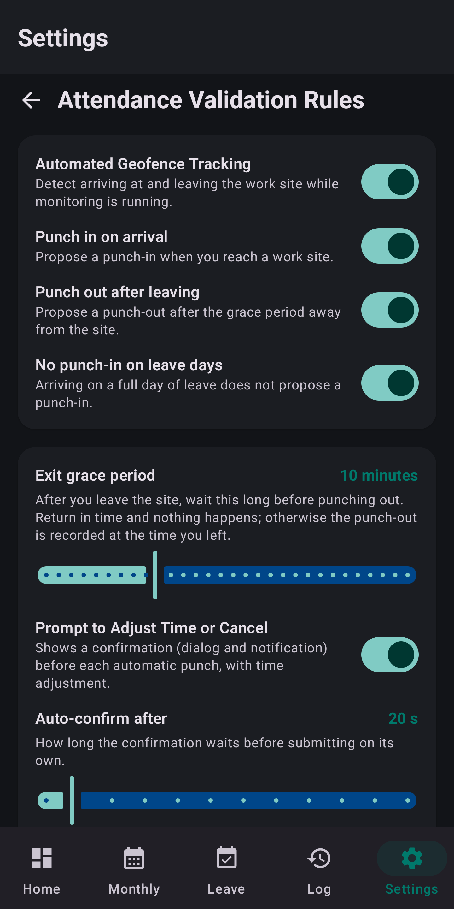

  

# GeoPunch

**Automatic punch in/out for your OrangeHRM server when you arrive at work.**

This is the public home of GeoPunch for Android: **bug reports, feature requests, questions and release notes**. The app's source code is not published here.

> This application is an independent third-party tool and is not affiliated with, endorsed by, sponsored by, or associated with OrangeHRM Inc. in any manner. "OrangeHRM" is a trademark of its respective owner and is used here only to describe the server software the app connects to.

## What it does

GeoPunch punches you in when you arrive at work and out when you leave, straight into your company's self-hosted **OrangeHRM 5** system. When you arrive, it asks "Punch in?" with a short countdown, so you can confirm, adjust the time or cancel. When you leave, it waits a grace period you choose before proposing a punch-out, timed at the moment you actually left. There is no GeoPunch account or cloud service: the app talks only to your company's server.

| Home | Confirm punch | Monthly attendance | Leave |
|:---:|:---:|:---:|:---:|
|  |  |  |  |

| Work site | Attendance log | Attendance rules |
|:---:|:---:|:---:|
|  |  |  |

### Features

- **Geofence punching**: work sites drawn on an OpenStreetMap map. Arriving proposes a punch-in; leaving starts an exit grace period, then proposes a punch-out.
- **Confirm before every automatic punch**: a dialog and a notification with an auto-confirm countdown. Confirm, cancel or adjust the time.
- **Office Wi-Fi**: being on a site's Wi-Fi counts as being on site, even where GPS is weak indoors.
- **Rules**: skips weekends, holidays and full days of leave; a time window for automatic punching; "Stay in today"; one attendance record per day; a forgotten punch-out reminder.
- **Offline-safe**: punches are saved on the phone and sent when the network comes back, without duplicates.
- **Attendance and leave**: monthly overview with a daily target, add or correct missed punches, leave balances, apply for and cancel leave.
- **Extras**: home-screen widget, Quick Settings tile, launcher shortcuts, light and dark theme, 12/24-hour clock, English, Hebrew and Russian.

## Get the app

GeoPunch is on [Google Play](https://play.google.com/store/apps/details?id=com.hrm.punchclock). While the closed test runs, the store page opens only for enrolled testers: to join, email alkaes@gmail.com with the Google account you use on your phone. Don't post that address in an issue: issues are public.

Requirements:
- Android 7.0 or newer.
- An OrangeHRM **5.x** server reachable over **HTTPS** (plain HTTP is refused), and your employee account on it.
- To punch with an adjusted time, the administrator must enable *"Employee can change current time when punching in/out"*. Without it the server accepts only punches within about 3 minutes of now.

## Report a problem or suggest a feature

From the version after 1.2, **Settings → About & Legal → Report a problem** in the app opens the bug report with your app version and phone already filled in.

| I want to… | Use |
|---|---|
| Report something that doesn't work | [Bug report](https://github.com/alkaes/GeoPunch/issues/new?template=bug_report.yml) |
| Say the app can't sign in or sync with my server | [Server compatibility](https://github.com/alkaes/GeoPunch/issues/new?template=server_compatibility.yml) |
| Ask for a new feature or a change | [Feature request](https://github.com/alkaes/GeoPunch/issues/new?template=feature_request.yml) |
| Report a translation mistake or offer a new language | [Translation](https://github.com/alkaes/GeoPunch/issues/new?template=translation.yml) |
| Report a security vulnerability | **Not an issue**: see [SECURITY.md](SECURITY.md) |

Before opening an issue, search the [existing issues](https://github.com/alkaes/GeoPunch/issues?q=is%3Aissue) and add a 👍 to the one that matches instead of opening a duplicate. Votes are how feature requests are prioritised.

### Keep private data out of issues

Everything here is public. **Never post:**
- your company's server address, your username or password;
- names, photos or employee IDs of you or your colleagues;
- the exact address or coordinates of your workplace or home;
- screenshots that show any of the above (crop or blur them first).

"A self-hosted OrangeHRM 5.6 on HTTPS behind nginx" is all the server detail an issue needs. If a problem can't be described without private details, say so in the issue and email them instead.

## Frequently asked questions

**Does GeoPunch track my location in the background?**
No. Location is read only while the app is open or while its monitoring notification is showing, and positions are compared with your work sites on the phone. The app never sends your position to your server or to the developer. See the [privacy policy](https://alkaes.github.io/GeoPunch/privacy/).

**The app didn't punch me in when I arrived.**
Check the status strip on Home: monitoring stopped, notifications off, a day off or holiday, leave, or outside the automatic punch-in time window all prevent it on purpose. Some phones (Samsung, Xiaomi, Huawei and others) stop apps aggressively: set GeoPunch's battery usage to *Unrestricted*. If none of that explains it, open a bug report.

**My punch failed with "time refused".**
Your server only accepts punches at the current time. Ask your administrator to enable *"Employee can change current time when punching in/out"* if you want to confirm punches with an adjusted time.

**Does it work with OrangeHRM 4, OrangeHRM Starter cloud or another HR system?**
GeoPunch is built for OrangeHRM 5.x. If you have a different setup, open a [server compatibility](https://github.com/alkaes/GeoPunch/issues/new?template=server_compatibility.yml) issue; it helps decide what to support next.

**Is there an iPhone version?**
Not yet. If you want one, add a 👍 to the iOS [feature request](https://github.com/alkaes/GeoPunch/issues?q=is%3Aissue+label%3Aenhancement+iOS), or open it if it isn't there.

## Release notes

See [CHANGELOG.md](CHANGELOG.md) and the [Releases](https://github.com/alkaes/GeoPunch/releases) page.

## Support the project

GeoPunch is free, with no ads and no tracking. If it saves you time, you can support its development through [PayPal](https://www.paypal.me/alkaes) or the **Sponsor** button at the top of this page. Support is entirely optional and doesn't unlock anything in the app.

## Contact

alkaes@gmail.com, for anything that doesn't belong in a public issue.

Privacy policy: https://alkaes.github.io/GeoPunch/privacy/

Google Play and the Google Play logo are trademarks of Google LLC.
